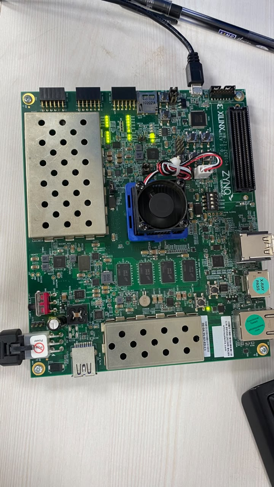
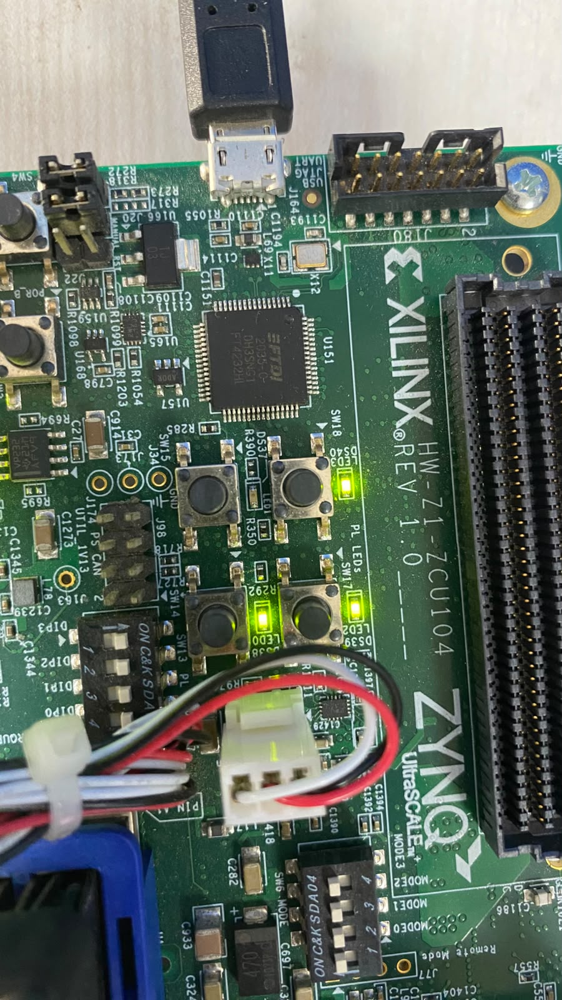

# Five-Stage RV32I Subset Processor

A new, isolated 32-bit in-order processor portfolio project for RTL design and design verification roles. Intended pipeline: **IF → ID → EX → MEM → WB**.

## Status

**The processor and initial verification milestones are complete.** The three-seed expanded UVM regression passed in Vivado 2026.1 XSIM/UVM 1.2 with 225 retirements per seed, 37/37 instruction bins, 12/12 branch condition/outcome bins, reset and hazard crosses covered, and zero UVM warnings/errors/fatals. The workload-specific measured CPI was 1.200, 1.213, and 1.169 for seeds 1, 17, and 20261101 respectively; it excludes reset and empty-pipeline cycles and is not an FPGA or silicon performance result. The Icarus directed suite and 40-step Yosys 0.52/Z3 formal check passed in WSL. The latest reported GitHub Actions run passed on `main` at commit `b1ebce0` (run `41454031684`), running the portable directed regression and bounded formal checks.


| XSIM/UVM seed | Active pipeline cycles | Retired | Load-use stalls | Redirects | Measured CPI |
|---:|---:|---:|---:|---:|---:|
| 1 | 270 | 225 | 7 | 17 | 1.200 |
| 17 | 273 | 225 | 6 | 19 | 1.213 |
| 20261101 | 263 | 225 | 6 | 14 | 1.169 |

The synthesis/timing report flow is available in [`scripts/run_vivado_synthesis.ps1`](scripts/run_vivado_synthesis.ps1). It targets the ZCU104 part and a 10 ns clock by default. It reports post-synthesis estimates only; no placement, routing, board I/O constraints, bitstream, or silicon measurements are included. The user ran Vivado 2026.1 synthesis successfully for the default target with zero errors. The utilization report shows 1,688 CLB LUTs (0.73%), 1,610 registers (0.35%), 44 CARRY8, 141 F7 muxes, and no BRAM/DSP use. The synthesized timing summary reports WNS=6.161 ns and TNS=0 ns at 100 MHz, with all specified constraints met. These are post-synthesis estimates; placement/routing and board I/O constraints were not applied.

An optional ZCU104 board demo wraps the core with a small ROM/RAM and LEDs. The user ran the portable Icarus regression: the two prior directed tests passed, and the demo passed in 11 cycles with stored values 12 and 13 and LEDs=`D`. Vivado 2026.1 completed place-and-route and generated a bitstream with zero DRC errors. In the final clock-pin-corrected implementation, the router reported estimated WNS=3.777 ns, WHS=0.021 ns, TNS=0 ns, and THS=0 ns against the 8 ns (125 MHz) clock. The reported implementation utilization is 760 CLB LUTs (0.33%), 1,088 registers (0.24%), 22 CARRY8, 64 F7 muxes, and 32 F8 muxes. The user programmed the board and observed the expected LED pattern, `1101` (DS37 off; DS38, DS39, and DS40 on). One input and four outputs have no I/O delay constraints, so this is not complete board I/O timing signoff or a silicon measurement. See [`docs/zcu104_demo.md`](docs/zcu104_demo.md).

This repository is isolated from the user's other projects. No other repositories, portfolio, releases, or remote branches have been modified.

## ISA scope

The planned core supports 37 RV32I integer instructions: arithmetic/logic, byte/halfword/word loads and stores, conditional branches, jumps, and upper immediates. `FENCE`, `ECALL`, and `EBREAK` are intentionally unsupported, so this will be described as an **RV32I subset**, not a fully RV32I-compliant implementation. See [`docs/processor_spec.md`](docs/processor_spec.md).

## Documents

- [`docs/processor_spec.md`](docs/processor_spec.md): architecture, exact instruction set, pipeline behavior, memory, reset, alignment, and limits.
- [`docs/test_plan.md`](docs/test_plan.md): reference model, scoreboard, directed/random tests, assertions, coverage, formal, and CI.
- [`docs/milestones.md`](docs/milestones.md): reviewable progress and exit criteria.
- [`docs/tooling.md`](docs/tooling.md): availability checks for PowerShell and WSL.
- [`docs/vivado_synthesis.md`](docs/vivado_synthesis.md): reproducible synthesis/timing estimates and their limits.
- [`docs/zcu104_demo.md`](docs/zcu104_demo.md): board wrapper, demo program, constraints, and run instructions.

## Tool check commands

PowerShell commands: Set-Location to the repository; run `git status --short --branch`; then run `Get-Command git, python, vivado, xvlog, xelab, xsim -ErrorAction SilentlyContinue | Select-Object Name, Source`.

WSL commands:

```bash
cd <path-to-this-repository>
git status --short --branch
for tool in iverilog vvp yosys z3 gtkwave; do
  if command -v "$tool" >/dev/null 2>&1; then
    printf '%-12s %s\n' "$tool" "$(command -v "$tool")"
  else
    printf '%-12s unavailable\n' "$tool"
  fi
done
```

The current Codex Linux environment does not expose Icarus, Yosys, Z3, Verilator, XSIM, or PowerShell on `PATH`. The user supplied successful WSL output for Icarus, Yosys 0.52, and Z3, and successful Windows output for Vivado 2026.1/XSim with UVM 1.2.

## Basic smoke regression

From WSL run `./scripts/run_iverilog.sh`. From PowerShell run the directed XSIM suite with `powershell -NoProfile -ExecutionPolicy Bypass -File .\scripts\run_xsim_smoke.ps1`. The smoke program covers arithmetic/immediate operations, LUI/AUIPC, all five load forms, all three store forms, retirement order, and illegal-instruction stop. `tb_hazard_control` covers forwarding, load-use stalls, branch/jump redirects, and wrong-path suppression; the user has run both directed tests successfully in XSIM.

For the UVM reference-model test, use a Vivado 2026.1 PowerShell prompt and run `powershell -NoProfile -ExecutionPolicy Bypass -File .\scripts\run_xsim_uvm.ps1`. It uses UVM 1.2, runs three fixed SystemVerilog seeds using XSIM's `-sv_seed` option, saves a log and WDB waveform per seed, and checks scoreboard, coverage, and safety-check results. This UVM test is simulator-specific; the Icarus script remains the portable directed suite.

## Current verification limits

The earlier baseline UVM seeds retired 148 instructions and generated only R-type, I-type, loads, and stores. The expanded regression passed its three fixed seeds after correcting the model's SRA/SRAI sign-fill handling. Exhaustive boundary values and a complete formal architectural-equivalence proof are not claimed. The bounded formal safety check passed for 40 SMT steps; no unbounded proof is claimed.

## Formal and CI

`scripts/run_formal.sh` passed through 40 SMT steps with the latest assertions in the user's WSL run. GitHub Actions (`.github/workflows/rtl-regression.yml`) most recently passed on commit `b1ebce0` (run `41454031684`) and runs the portable Icarus directed tests and formal job on pushes and pull requests. Hosted CI does not run the Vivado-specific UVM suite. See [`docs/milestones.md`](docs/milestones.md) for run evidence and limits.

<!-- ZCU104-HARDWARE-EVIDENCE -->

| Board overview | PL LED result |
|---|---|
|  |  |
| ZCU104 HW-Z1 Rev 1.0 used for the processor demo. | Expected `1101`: DS37 off; DS38, DS39, and DS40 on. |

<!-- /ZCU104-HARDWARE-EVIDENCE -->
