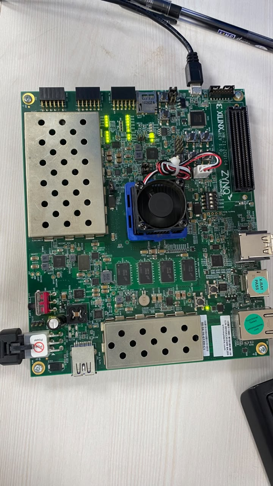
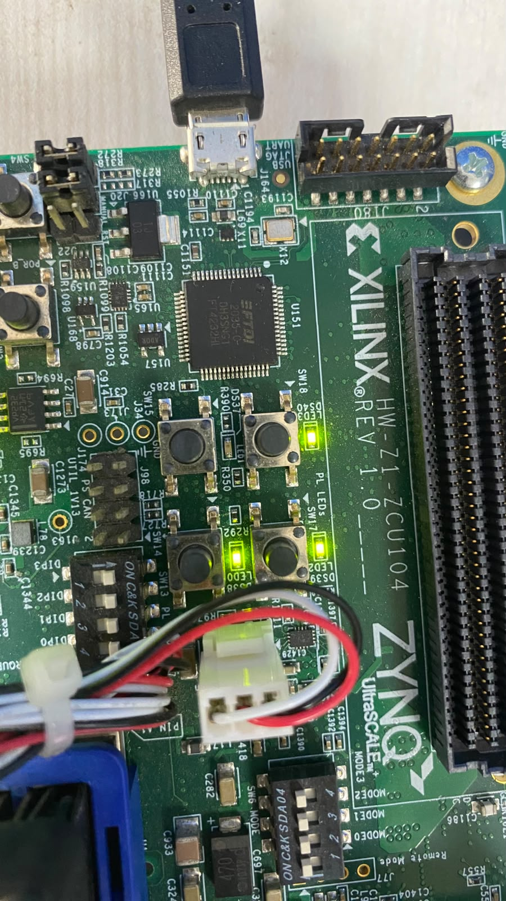

# ZCU104 Standalone Demo

## What it contains

`rtl/rv32i_zcu104_top.sv` wraps the processor demonstration system for the ZCU104. It accepts the board's differential 125 MHz PL clock and active-high CPU reset pushbutton, and drives the four active-high user LEDs. The reset pushbutton asynchronously asserts a two-flop reset synchronizer; release reaches the core synchronously.

`rtl/rv32i_demo_system.sv` instantiates the existing processor, a 32-word combinational instruction ROM, and a 16-word (64-byte), little-endian data memory with combinational reads and byte-strobed synchronous writes. This is a small teaching/demo memory, not an AXI subsystem. The read interface is asynchronous, so the implementation flow will report the actual inferred resource mapping; do not assume it maps to block RAM.

## Demo program and expected result

The ROM program performs the following sequence:

1. Set `x1=5` and `x2=7`.
2. Add them, then store 12 to data address 0.
3. Load the value back and add 1, exercising the core's load-use interlock.
4. Store 13 to data address 4.
5. Loop at the final `JAL`.

After the word store to address 4, the LEDs display hexadecimal `D` (binary `1101`). If the processor reports a stop/fault, all four LEDs illuminate. The demonstration testbench checks both memory words, the LED value, no stop indication, and an 80-cycle watchdog. The user ran it in WSL Icarus; it passed in 11 cycles. The same run passed the existing smoke test (37 retires) and hazard test (56 retires, four load-use stalls).

## ZCU104 constraints

`constraints/zcu104_demo.xdc` uses the device pins from the AMD ZCU104 Evaluation Board User Guide UG1267: `CLK_125_P/N` on H11/G11 at 125 MHz, CPU reset SW20 on M11, and active-high LEDs on D5, D6, A5, and B5. The guide identifies the reset pushbutton as active-high and the LEDs as active-high. See [AMD UG1267, Clock Sources and User I/O](https://docs.amd.com/api/khub/documents/g76en4BfB6qIp2gHDRkQxg/content), Tables 3-12, 3-13, and 3-24.

The clock is constrained to 8.000 ns. The reset input is false-pathed because it is asynchronous and passes through the reset synchronizer. No external timing budget is assigned to the LEDs; review unconstrained paths in the implementation timing report. The clock and LED pin mapping must match the user's actual board revision before programming.

## Run the demo simulation

From PowerShell with Vivado 2026.1:

```powershell
powershell -NoProfile -ExecutionPolicy Bypass -File .\scripts\run_xsim_demo.ps1
```

The portable WSL regression also runs the demo top:

```bash
bash scripts/run_iverilog.sh
```

## Run implementation

From the project root in a Vivado 2026.1 PowerShell prompt:

```powershell
powershell -NoProfile -ExecutionPolicy Bypass -File .\scripts\run_vivado_implementation.ps1
```

The user ran this flow in Vivado 2026.1. Synthesis, placement, physical optimization, routing, DRC, and bitstream generation completed; Vivado reported zero DRC errors before bitstream generation. The router log reported estimated WNS=3.887 ns, TNS=0 ns, WHS=0.021 ns, and THS=0 ns against the 8 ns clock. The reviewed post-route timing summary reports WNS=3.887 ns and TNS=0 ns on `clk_125`, with zero failing endpoints among 2,696 and WPWS=3.725 ns. The critical max-delay path reports 3.891 ns data-path delay. The utilization report lists 760 CLB LUTs (0.33%), 1,088 CLB registers (0.24%), 22 CARRY8 (0.08%), 64 F7 muxes (0.06%), and 32 F8 muxes (0.06%). The DRC summary reports zero checks.

The timing report also flags one input and four outputs without I/O delay constraints. CPU reset is false-pathed by design; no external LED timing budget was set. Vivado says the specified clock constraints are met, but these numbers do not constitute complete board I/O timing signoff or silicon measurements. The flow does not program the board, and no physical board run is claimed.

## Limits

The program is fixed in ROM; there is no software loader, UART, debugger, AXI bus, operating system, or general-purpose memory map. The core's simple combinational memory interface limits memory choice and clock timing. This demo is a board wrapper around the existing RV32I subset, not an RV32I compliance claim or production processor system.

## ZCU104 board validation

- Board: ZCU104, programmed with the `rv32i_zcu104_top` bitstream.
- Clock pins: `clk_125_p` = F23, `clk_125_n` = E23.
- Observed: DS37 off; DS38, DS39, and DS40 on, matching the expected `1101` output.
- Vivado 2026.1 implementation: routing completed with zero unrouted nets and zero DRC errors.
- Router-estimated timing: WNS 3.777 ns, WHS 0.021 ns, TNS 0 ns, THS 0 ns. These are implementation estimates.

<!-- ZCU104-BOARD-PHOTOS -->
### Board photos



<!-- /ZCU104-BOARD-PHOTOS -->
